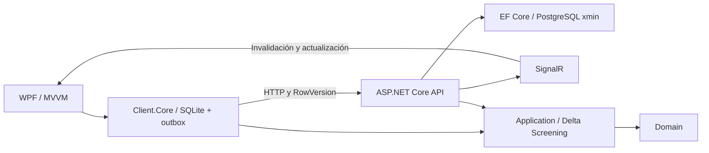

# Constructora y certificaciones

Base funcional de una aplicación cliente-servidor **.NET 8**, sin API keys. El servidor utiliza PostgreSQL y SignalR; WPF trabaja sobre SQLite y sincroniza mediante una cola local persistente. Los importes usan `decimal` y los identificadores se generan en el cliente para permitir altas sin conexión.

## Estructura

```text
src/
  Constructora.Domain/                 Entidades y enum de estados
  Constructora.Application/            DTO, contratos y Delta Screening BIM
  Constructora.Infrastructure.Server/  EF Core 8, PostgreSQL, xmin y recibos de operaciones
  Constructora.Server/                 ASP.NET Core Web API y SignalR
  Constructora.Client.Core/            SQLite, catálogo, outbox y sincronización HTTP
  Constructora.Infrastructure.Ifc/     Lector IFC local y normalización de cantidades
  Constructora.Client.Bim/             Historial BIM, originales y vínculos a partidas
  Constructora.Wpf/                    Interfaz Windows, MVVM, DI y sincronización periódica
tests/
  Constructora.Application.Tests/      Comparación BIM y valoración económica
  Constructora.Client.Core.Tests/      SQLite real y transporte HTTP controlado
  Constructora.Integration.Tests/      API, PostgreSQL real, concurrencia y SignalR
  Constructora.Infrastructure.Ifc.Tests/ Lectura IFC, unidades y archivos inválidos
  Constructora.Client.Bim.Tests/       Historial BIM, vínculos y archivos locales
  Constructora.Bim.Integration.Tests/  Flujo IFC completo con SQLite real
```

Las dependencias apuntan al dominio y a los contratos compartidos; el servidor no referencia WPF ni SQLite. La lógica local se puede probar en Linux sin cargar bibliotecas de interfaz de Windows.



## Entorno cloud Linux

Requiere Docker y acceso HTTPS a `builds.dotnet.microsoft.com`, NuGet y al registro oficial de Docker. Los scripts utilizan rutas de caché dentro de `/workspace`; `XDG_RUNTIME_DIR` evita que el runtime intente crear sus mutex en un directorio personal de solo lectura.

Desde `/workspace/Certificaciones-Constructora`:

```bash
bash scripts/cloud-install.sh
bash scripts/start-dev.sh
```

El instalador verifica el SHA-512 del SDK **8.0.426**, restaura con los lockfiles, compila todos los proyectos —incluido WPF mediante `EnableWindowsTargeting`— y descarga PostgreSQL 16 fijado por digest. `start-dev.sh` inicia PostgreSQL y mantiene la API en primer plano. En otra terminal:

```bash
curl --fail http://127.0.0.1:5080/health
bash scripts/validate.sh
```

Las direcciones de loopback se usan para comprobaciones locales. La interfaz WPF solo se ejecuta en Windows. La compilación en Linux no verifica el comportamiento visual.

Los datos de PostgreSQL se conservan en `/workspace/.constructora/postgres`; los procesos y contenedores se deben iniciar de nuevo al restaurar una máquina. No se necesitan worktrees: cada tarea cloud ya dispone de un entorno aislado. Para usar directamente el SDK instalado:

```bash
source scripts/dotnet-env.sh
dotnet build Constructora.sln --no-restore
```

El PostgreSQL de desarrollo usa autenticación `trust`, publicado exclusivamente en `127.0.0.1:54329`. La API de desarrollo escucha en `127.0.0.1:5080`. Esta configuración es para una máquina de desarrollo local. Un despliegue compartido necesita autenticación de usuarios, permisos por proyecto, TLS y autenticación PostgreSQL adecuada; no requiere introducir API keys.

## Servidor y datos iniciales

También puede utilizarse una instalación propia de PostgreSQL. Configurar `ConnectionStrings__Servidor` antes de ejecutar:

```bash
dotnet run --project src/Constructora.Server
```

`Database__Initialize=true` crea el esquema inicial con `EnsureCreatedAsync`. Se utiliza únicamente para una base nueva de esta versión; no actualiza esquemas existentes. Para evolucionar una instalación con datos, generar y revisar migraciones EF Core antes de desplegar. La aplicación no introduce proyectos ni partidas de empresa automáticamente.

Para probar la interfaz con datos de demostración, con la API ya arrancada:

```bash
docker exec -i constructora-postgres psql -v ON_ERROR_STOP=1 -U constructora -d constructora < scripts/cargar-ejemplo.sql
```

La carga es explícita e idempotente. En instalaciones reales, los proyectos y las partidas se incorporan desde el sistema de gestión o mediante una carga validada; esta base se centra en la edición de certificaciones.

| Ruta | Comportamiento |
| --- | --- |
| `GET /health` | Comprueba conexión real a PostgreSQL |
| `GET /api/proyectos` | Catálogo de proyectos |
| `GET /api/proyectos/{id}/partidas` | Partidas de un proyecto |
| `GET /api/certificaciones?proyectoId={id}` | Certificaciones con líneas y versión |
| `GET /api/certificaciones/{id}` | Una certificación |
| `POST /api/certificaciones/sincronizar` | Alta o actualización del agregado completo |
| `/hubs/certificaciones` | SignalR, evento `CertificacionActualizada` |

Solicitud de ejemplo; usar los identificadores del catálogo de demostración y un `operacionId` nuevo para cada edición:

```json
{
  "operacionId": "44444444-4444-4444-4444-444444444444",
  "certificacion": {
    "id": "55555555-5555-5555-5555-555555555555",
    "proyectoId": "11111111-1111-1111-1111-111111111111",
    "numeroCertificacion": 1,
    "fecha": "2026-10-15",
    "estado": 0,
    "rowVersion": 0,
    "lineas": [{
      "id": "66666666-6666-6666-6666-666666666666",
      "partidaId": "22222222-2222-2222-2222-222222222222",
      "cantidadAcumuladaAnterior": 0,
      "cantidadPeriodo": 12,
      "porcentajeAvance": 10
    }]
  }
}
```

La respuesta contiene la `rowVersion` de PostgreSQL. En actualizaciones se debe enviar esa versión, nunca cero. Los estados JSON son `0=Borrador`, `1=Aprobada`, `2=Facturada`. Los estados no retroceden y una certificación facturada es inmutable. Las cantidades admiten hasta cuatro decimales y el avance está entre 0 y 100.

## Concurrencia y sincronización

1. El comando de guardar persiste la certificación y una operación en la misma transacción SQLite. No espera a una petición HTTP.
2. La sincronización prueba la disponibilidad de la API y envía operaciones pendientes en orden. La operación y su cuerpo se conservan para reintentar tras reinicios o respuestas perdidas.
3. El servidor comprueba la versión `xmin` del agregado, incluso si solo han cambiado líneas. Guarda los datos y el recibo de idempotencia en una transacción PostgreSQL.
4. Una repetición del mismo `operacionId` y contenido devuelve su respuesta original. Reutilizar el identificador con otros datos devuelve `409`.
5. Un conflicto devuelve `409` con la versión del servidor. SQLite conserva los cambios del usuario y la copia remota; se requiere una resolución explícita, sin sobrescribir automáticamente.
6. El acuse actualiza la versión local. Si se guardó otra revisión mientras había un envío en curso, esa revisión permanece pendiente.
7. Después del commit, SignalR avisa a los clientes. Las notificaciones sirven para refrescar datos; el estado duradero reside en las bases de datos. El refresco periódico permite recuperar cambios tras desconexiones.

El catálogo debe descargarse al menos una vez antes de trabajar sin red. La cola conserva operaciones mientras la API no esté disponible. Los conflictos y errores de validación deben revisarse; no se presentan como guardados en el servidor.

Una respuesta de validación rechazada bloquea solo las operaciones de esa certificación. Un guardado correctivo sustituye los envíos rechazados y los que todavía no se enviaron; las operaciones de resultado incierto conservan su identidad hasta obtener confirmación. Un editor abierto antes de una actualización remota conserva su trabajo como conflicto local, en lugar de adoptar automáticamente el token nuevo.

Aceptar la versión del servidor reemplaza la copia local y elimina su cola sin enviar otro POST. Así también puede aceptarse una certificación remota facturada, cuyo contenido es inmutable. Conservar la versión local crea una operación nueva con el token remoto revisado.

## Cliente WPF en Windows

Para una prueba sin instalar SDK, Docker ni PostgreSQL, utiliza el paquete portátil
`Constructora-Windows-portatil.zip`: extrae todos sus archivos y abre `Probar.cmd`.
Incluye el runtime de .NET y WPF para Windows x64. El lanzador prepara un catálogo
de demostración en SQLite sin sobrescribir registros existentes. Permite crear,
editar y guardar certificaciones sin conexión; la sincronización requiere una API
accesible y PostgreSQL en el servidor.

El paquete se genera desde el entorno cloud con
`bash scripts/package-windows.sh`. Los ejecutables Windows se compilan y se
inspeccionan en Linux; la ejecución visual debe comprobarse en Windows. Consulta
[las instrucciones del lanzador](tools/Constructora.Prueba/README.md).

GitHub Actions también genera y publica el paquete al recibir una etiqueta de
prueba, por ejemplo `v0.1.0-prueba-windows`. El flujo conserva el ZIP como artefacto
y registra su resultado en `estado-publicacion-windows/publicacion.json`, con la
versión del código, el enlace de descarga y su SHA-256. Los archivos publicados
están en la sección **Releases** del repositorio.

Para desarrollar desde el código fuente:

Instalar .NET SDK 8.0.426 y arrancar la API accesible desde el equipo Windows. En PowerShell, desde el repositorio:

```powershell
$env:CONSTRUCTORA_API_URL = 'http://127.0.0.1:5080/'
dotnet restore Constructora.sln --locked-mode
dotnet run --project src/Constructora.Wpf
```

Seleccionar proyecto, cargar o crear una certificación, editar mediciones y guardar. El almacenamiento SQLite y los registros están bajo la carpeta de datos locales del usuario. La URL se configura al arrancar; si el servidor está en otro equipo, utilizar su dirección y habilitar la configuración de red y seguridad apropiada.

## Delta Screening BIM

La pestaña **Modelo IFC** vincula archivos IFC con los proyectos y las partidas,
conserva revisiones y permite comparar sus mediciones. Consulta la
[guía de IFC y los ejemplos](docs/IFC.md) para el flujo completo y su alcance local.

`DeltaScreeningService.Comparar` recibe versión anterior, versión nueva y tarifas tipadas por código de partida. Compara por `GlobalId` en O(n), detecta altas, bajas y cambios de volumen, área o partida; las modificaciones incluyen el elemento anterior y el nuevo.

```csharp
using Constructora.Application;

var anterior = new[] { new ElementoBim("ifc-1", "Estructura", "Muro", 2, 8, "EST-01") };
var nueva = new[] { new ElementoBim("ifc-1", "Estructura", "Muro", 3, 8, "EST-01") };
var tarifas = new[] { new TarifaPartidaBim("EST-01", UnidadMedicionBim.MetroCubico, 150m) };
var resultado = new DeltaScreeningService().Comparar(anterior, nueva, tarifas);
// resultado.ElementosModificados.Count == 1; resultado.ImpactoEconomicoEstimado == 150m
```

Las tarifas distinguen m³, m² y unidad. El impacto suma coste de altas, resta bajas y valora cada modificación como coste nuevo menos coste anterior; contempla el cambio de partida. Es una estimación por mediciones, sin impuestos, desperdicios ni costes indirectos. Se ignoran diferencias geométricas dentro de tolerancias absoluta y relativa configurables (por defecto `1e-6`). Se rechazan claves duplicadas, mediciones no finitas o negativas y tarifas ausentes.

## Validación

`scripts/validate.sh` compila la solución y ejecuta los seis proyectos de pruebas. La integración del servidor utiliza bases temporales independientes y las elimina al finalizar; requiere PostgreSQL disponible. `CONSTRUCTORA_TEST_POSTGRES` permite indicar una conexión alternativa con permiso de crear bases de pruebas. SQLite se prueba con archivos reales y HTTP controlado; PostgreSQL se prueba con su proveedor real, sin sustituir la concurrencia por EF InMemory.

Las comprobaciones cubren comparación y valoración, sincronización y conflictos, importación IFC con distintas unidades, historial local y el flujo completo con los modelos de ejemplo. La integración del servidor incluye dos clientes con archivos SQLite separados, sincronización con PostgreSQL, conflicto y resolución explícita, además de notificaciones SignalR verificadas después del commit. Las pruebas BIM verifican también que importar y comparar modelos conserva las certificaciones existentes.

La ejecución visual WPF queda pendiente de un equipo Windows. La publicación de este entorno cloud se realiza desde la configuración del producto; guardar scripts no lo publica ni valida su restauración en una tarea nueva.
